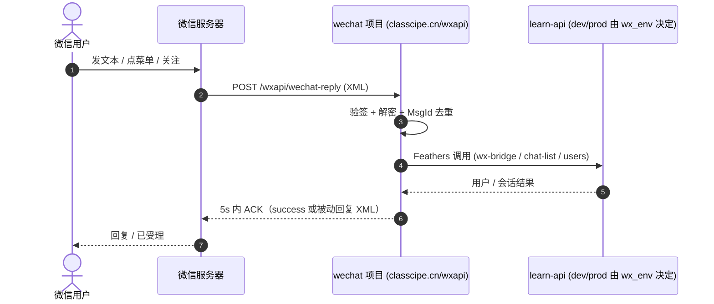
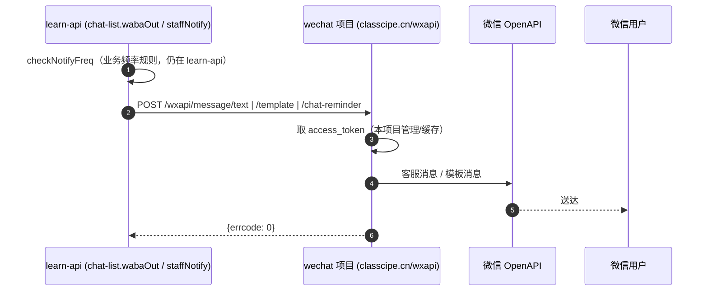
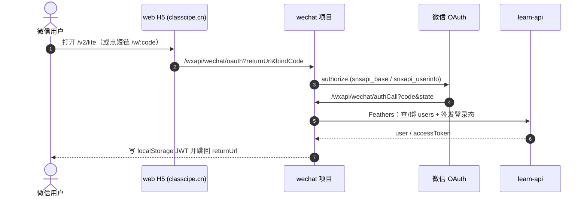

# 微信接入方案（认证服务号）

> 目标：在现有 WABA（WhatsApp）架构上新增「微信」这一消息通道，复用既有会话、通知与账号路由逻辑。
>
> 关联文档：[waba.md](waba.md)（WABA 开发环境集成与架构指南，微信侧的通道映射可对照阅读）、[chat.md](chat.md)（会话 / 分配 / AI 托管 / 离线通知等**通道无关**的业务规则）。
>
> 说明：本文由 [waba.md](waba.md) 中的「微信接入方案分析」部分拆分而成。
>
> **2026-10 架构调整（本文重点）**：微信接入相关的接口将从 `learn-api` 中**拆分到一个新的独立项目 `wechat`**，并明确了两个项目之间的调用契约。见第 0、1 节与第 6 节；代码落点与迁移计划见第 11 节。
>
> 路径约定：本文档位于 `work/doc/fio/`。`wechat` 与 `learn-api` 现为**同级目录**（`work/wechat`、`work/learn-api`），文中出现的 `../wechat`、`../learn-api` 即从其中一方出发的兄弟目录。

---

## 0. 变更摘要（本次架构调整）

### 0.1 调整前的痛点

原实现把**微信协议细节**（签名校验、AES 加解密、XML 解析、网页授权、`access_token`、客服消息/模板消息/菜单 API）与**业务逻辑**（会话、用户身份、频率限制）都放在 `learn-api` 同一个进程里：

- 微信要求回调地址落在 **`classcipe.cn` 域名**（已备案，且为公众号网页授权域名），而业务 API 在 **`classcipe.com/fio`**，两者混在一个进程里，部署与域名治理都别扭；
- 微信联调（改签名、改模板、发菜单）会牵动整个业务服务重启，回归成本高；
- 微信协议代码与 `chat-list`/`users` 业务代码耦合，难以独立测试与复用。

### 0.2 调整后的目标

拆成**三个项目分层**：`wechat`（微信协议适配，新增）→ `learn-api`（Feathers 业务 API，现有）→ `web`（H5 前端，现有）。

| 项 | 调整前 | 调整后 |
| :--- | :--- | :--- |
| 微信 Webhook / OAuth / 菜单 / 加解密 | 在 `learn-api` 内（`src/middleware/wechat.ts`、`src/services/wechat/`） | 迁移到独立项目 **`wechat`** |
| 微信回调地址 | `classcipe.com/fio/wechat-reply` | **`https://classcipe.cn/wxapi/wechat-reply`** |
| 出站（客服消息 / 模板消息 / 菜单） | 由 `learn-api` 直连 `api.weixin.qq.com` | `learn-api` **请求 `https://classcipe.cn/wxapi/`**，由 `wechat` 项目转发到微信 |
| 数据访问 | `learn-api` 直连 MongoDB / Redis | `wechat` **不直连数据库**，用 **Feathers 客户端**透传到 `learn-api` |
| 业务逻辑（会话 / 身份 / 频率） | 在 `learn-api` | **仍在 `learn-api`**（不变） |
| 开发 / 产线区分 | （未实现）生产转发到 dev | **`wechat` 单一实例**：入站 / 身份按 `wx_env:<openid>` 选 dev/prod 的 `learn-api`；出站按请求**来源域名**判定 dev/prod |

### 0.3 三条硬性约束（本次调整的来源）

1. 新项目位置 `../wechat`，**本地开发监听 `localhost:3000`**，**产线地址 `https://classcipe.cn/wxapi/`**。
2. 新项目**不直接连数据库**，通过 **Feathers 客户端**把数据透传到 `learn-api` 的接口。Feathers 接口项目在 `../learn-api`，**产线 `https://classcipe.com/fio/`**，**开发 `https://dev.classcipe.com/fio/`**。
3. `learn-api` 中的**出站消息**，通过请求 **`https://classcipe.cn/wxapi/`** 实现发送。

---

## 1. 整体架构

### 1.1 三项目分层与地址矩阵

| 项目 | 目录 | 本地开发 | 开发/测试环境 | 生产环境 | 职责 |
| :--- | :--- | :--- | :--- | :--- | :--- |
| **wechat**（新增） | `work/wechat`（`../wechat`） | `http://localhost:3000` | **不单独部署**（与产线同一实例） | `https://classcipe.cn/wxapi/` | 微信协议适配：验签、加解密、XML、OAuth、`access_token`、客服/模板消息、菜单；**不直连 DB** |
| **learn-api**（现有） | `work/learn-api`（`../learn-api`） | `http://localhost:3030` | `https://dev.classcipe.com/fio/` | `https://classcipe.com/fio/` | 业务与数据：`chat-list` 会话、`users` 身份、频率规则；对外是 Feathers API |
| **web**（现有） | `work/web` | Quasar dev | `https://dev.classcipe.com` | `https://classcipe.com`（微信内 H5 走 `https://classcipe.cn`） | H5 前端（`/v2/lite/*`） |

- `wechat` 项目的所有对外路径都挂在 **`/wxapi/`** 前缀下（本地即 `http://localhost:3000/wxapi/...`，产线即 `https://classcipe.cn/wxapi/...`）。
- `learn-api` 的 Feathers socket 路径为 **`/fio/socket.io/`**（前端 `plugin/app.js` 中 `feathersInit` 已如此配置），`wechat` 项目复用同一套连接方式。
- **`wechat` 不区分开发/产线部署**（单一实例）。它按 `wx_env:<openid>` 动态选择要调用的 `learn-api`：微信内发送 `/dev on` 后走 `https://dev.classcipe.com/fio/`、发送 `/dev 36` 后走 `https://dev.acanss.com/fio/`（本机部署），否则走 `https://classcipe.com/fio/`（见第 7 节）。
- 反向（`learn-api` → `wechat` 出站）时，dev 与 prod 的 `learn-api` 都指向同一 `wechat` 实例，`wechat` **按请求的来源域名**（`dev.classcipe.com` / `classcipe.com`）判定 dev/prod（见第 6.2 / 7 节）。

### 1.2 入站消息流（微信 → wechat → learn-api）



### 1.3 出站消息流（learn-api → wechat → 微信）



### 1.4 网页授权 / 免登录流（H5 → wechat → learn-api）



---

## 2. 先看 WABA 在本项目里承担了什么

结合 [chat.md](chat.md) 与本文档，WABA 实际提供五类能力，接入微信时必须逐一对应：

| # | WABA 能力 | 现有实现锚点 | 作用 |
| :-- | :--- | :--- | :--- |
| A | **入站消息 Webhook** | `/waba-reply` → `wabaIn` / `wabaStart` / `wabaEnd` | 客户在 WhatsApp 发消息，落库成 `chat` 会话 |
| B | **出站消息** | `wabaOut`：24h 内自由文本；24h 外 Utility 模板（只提醒+链接） | 客服回复 / 离线提醒 / AI 代回 |
| C | **账号路由 / 登录短链** | `/wac/:code` + `generateWabaCode(env)` | 把消息里的临时 code 映射到 `users`，实现绑定与跳转 |
| D | **身份标识** | `users.mobile`（E.164） | 微信里对应的是 `openid` / `unionid` |
| E | **开发/生产分流** | 生产 Redis `wa_env:<phone>` 代理到 `dev.classcipe.com` | 微信：`wechat` 单一实例，按 `wx_env:<openid>` 选用 dev/prod 的 `learn-api` |

**结论先行**：微信侧的通道必须满足「能被 Webhook 推送消息 + 48h 内可主动发客服消息 + 能做网页授权拿到用户身份 + 能发事务模板」。逐项比对后，**认证服务号**与 A/B/C/D 的契合度最高。

## 3. 四种微信通道能力对比

| 维度 | 订阅号 | 服务号 | 小程序 | 企业微信（含微信客服） |
| :--- | :--- | :--- | :--- | :--- |
| 消息接收 Webhook（对应 A） | ✅ 有 | ✅ 有 | ✅ 客服会话回调 | ✅ 回调 |
| 主动发消息窗口（对应 B） | ⚠️ 客服消息能力弱 | ✅ 客服消息 48h 内自由发 | ✅ 客服消息 48h 内 | ✅ 微信客服 48h 内 |
| 事务模板（对应 B 窗口外） | ⚠️ 受限 | ✅ 模板消息 / 订阅通知 | ✅ 订阅消息（需用户逐次订阅） | ✅ 应用消息（内部） |
| 网页授权拿 openid/unionid（对应 C/D） | ❌ 不支持 | ✅ `snsapi_base/userinfo` | ✅ `wx.login` → `code2Session` | ✅（外部联系人 / unionid） |
| 群发 / 触达 | 1 条/天 | 4 条/月 | 订阅消息 | 客户群发（有频率限制） |
| 用户可直达产品界面 | H5 | H5（可嵌 web-view） | ✅ 原生 | H5 |
| 认证 / 门槛 | 个人可注册 | **企业主体认证 300 元/年** | 认证 300 元/年 | 企业主体免费 |
| 适合场景 | 内容资讯 | **对外客户服务 + 通知 + 身份** | 沉浸式产品内体验 | **内部客服工作台 + 员工通知 + 客户联系** |

> 关键差异：**订阅号不支持网页授权**，无法承担 WABA 的「`/wac` 身份路由」角色，且主动触达弱，不适合客服；**小程序**能力强但要求用户从小程序入口进入，对外部家长用户的触达不如服务号自然；**企业微信**擅长「客服侧」和「内部员工」，直接面向外部客户时需借助「微信客服 / 客户联系」。

## 4. 推荐方案：只用「认证服务号」

**方案：只接入一个认证服务号**，作为微信侧唯一通道，一次性覆盖 WABA 的 A/B/C/D 全部能力，不引入企业微信或小程序。

- **入站消息 Webhook（A）**：`/wxapi/wechat-reply`（`wechat` 项目）接收消息/事件，转换为统一入站事件后复用 `chat` 会话逻辑。
- **48h 内出站（B）**：客服消息接口发自由文本，对应 WhatsApp 24h 自由文本窗口。
- **窗口外出站（B）**：模板消息，**只发提醒+网页链接、不携带聊天内容**，对应 Utility 事务模板。
- **身份与登录（C/D）**：网页授权 OAuth2 直接拿 `openid/unionid`，取代 `/wac/:code` 做绑定与登录。
- **客服侧离线提醒**：客服同样关注并绑定服务号，通过模板消息推送离线提醒（频率规则复用 [chat.md](chat.md)）。
- **前端入口**：自定义菜单 + 模板消息按钮 URL，指向 H5 聊天页。

> 为什么不用企业微信 / 小程序：企业微信的客服会话能力虽好，但**缺模板消息**、且网页授权面向企业成员而非任意微信用户；小程序要求用户从小程序入口进入、触达不如服务号自然。**单一服务号即可覆盖全部 A/B/C/D**，接入面最小、与 WABA 映射最直接。

## 5. 具体怎么接入（只用服务号）

### 5.1 准备与配置
1. 注册/认证**企业主体服务号**（300 元/年），完成微信认证（认证后才开放网页授权、模板消息、客服消息等高级接口）。
2. 在**微信开放平台**绑定该服务号（以及未来的小程序），以获取跨应用统一的 `unionid`。
3. 配置服务器：`基本配置` 中填写服务器地址 **`https://classcipe.cn/wxapi/wechat-reply`**、`Token`、`EncodingAESKey`（推荐安全模式）。这三项配置归属于 **`wechat` 项目**的环境变量（对应其配置里的 `wechat.appid` / `wechat.secret` / `wechat.token` / `wechat.EncodingAESKey`）。
4. 在 `功能设置` 中配置**网页授权域名** `classcipe.cn`（OAuth2 回调）与**业务域名**（菜单 `view` / H5 受限跳转）。

### 5.2 数据模型改动（`users` 增加微信身份，仍在 `learn-api`）
```js
wechat: {
  openid: String,        // 服务号内唯一
  unionid: String,       // 开放平台下跨应用唯一（推荐作为主键）
  nickname: String,
  avatar: String,
  subscribe: Boolean,    // 是否关注服务号
  subscribedAt: Date,
  boundAt: Date,
}
```
- 以 `unionid` 作为跨应用身份键；`openid` 仅在同一应用内有效（服务号 / 小程序各自不同）。
- 绑定优先级：`wechat.unionid` → `users.mobile`（家长手机号）→ 新建/引导注册。

### 5.3 入站消息（替代 `/waba-reply`，在 `wechat` 项目新增 `/wxapi/wechat-reply`）
1. 微信服务器把用户消息/事件 POST 到 `/wxapi/wechat-reply`（由 `wechat` 项目接收）。
2. `wechat` 项目校验 `signature`（`sha1(sort(token, timestamp, nonce))`），安全模式下再用 `EncodingAESKey` 解密报文。
3. 解析 XML：区分 `text`（用户文本）/ `event`（关注、取消关注、菜单点击、扫码）。
4. 转换为统一的 `channel inbound` 事件，**经 Feathers 客户端**调用 `learn-api` 以复用现有业务逻辑：
   - 已注册 → `wabaIn`（落库为 `chat`）；
   - 命中咨询类型 → `wabaStart(type)`；
   - 命中 `END_TRIGGERS` → `wabaEnd`；
   - 未注册 → 回复 `UNREGISTERED_REPLY` + 快捷注册链接：生成一次性 `wx_bind:<token>`（本服务内存 KV，30 分钟）暂存微信身份，链接指向 `${h5Site}/v2/lite/signup?wxBind=<token>`（注册页免手机号的微信分支；`h5Site` 按该 openid 的 `/dev` 环境取：`/dev on` → `https://dev.classcipe.com`、`/dev 36` → `https://dev.acanss.com`，默认 `siteUrl` = `https://classcipe.cn`，见 7.1），与 OAuth 未命中用户时的处理口径一致；注册页创建账号后调 `POST /wxapi/wechat/bind {token, uid}` 完成绑定并取回登录态（`accessToken`），直接进主页。
5. 微信要求 5s 内响应，超时重试 3 次：重活（AI、翻译、外部调用）应**先 ACK 再异步处理**，避免重复消费（用 `MsgId` 去重）。

### 5.4 出站消息（替代 `wabaOut`，对应 24h/48h 窗口）
- **48h 窗口内**：调用 `客服消息接口`（`POST /cgi-bin/message/custom/send`）发自由文本，对应 WABA 的 24h 自由文本。
- **48h 窗口外**：调用 `模板消息 / 订阅通知`，**只发提醒+网页链接，不携带聊天内容**，对应 WABA 的 Utility 模板。
  - 需在公众平台「模板消息」中申请模板（如 `chat_new_message_reminder`），保存 `template_id`；`url` 指向 H5 聊天页。
  - 频率上限直接复用 [chat.md](chat.md) 的规则：每用户全局 3 次/天、间隔 ≥ 2h，Redis 计数键为 `wx_user_notify:${uid}`（**计数逻辑仍留在 `learn-api`**）。
- **调用链（关键变化）**：`learn-api` 的 `chat-list.wabaOut` / `staffNotify` 不再直连微信，改为 **HTTP 请求 `wechat` 项目**（`POST https://classcipe.cn/wxapi/message/...`），由 `wechat` 项目发客服消息 / 模板消息。`learn-api` 内保留 `app.service('wechat')` 作为薄封装：**对外方法签名不变**（`sendTextMessage` / `sendTemplateMessage` / `sendChatReminder`），内部改成 HTTP 客户端，从而无需改动 `chat-list`。

### 5.5 账号路由 / 登录（替代 `/wac/:code`；由 `wechat` 项目承载 OAuth）
1. 用户在微信内点开链接或菜单进入 H5，服务端构造网页授权 URL：
   - `snsapi_base`（静默，仅拿 `openid`）用于已绑定用户免登录；
   - `snsapi_userinfo`（授权弹窗，可拿昵称头像）用于首次绑定。
2. 微信回调 `?code=&state=`：用 `code` 换 `access_token` + `openid` +（如有）`unionid`。
3. 按 5.2 的优先级匹配 `users`（经 Feathers 客户端查询）：命中即建立登录态并跳回 `state.returnUrl`；未命中则引导绑定手机号或注册。
4. 保留 `/wac/:code` 短链作为非微信渠道的通用入口；在微信内浏览器检测到 UA 含 `MicroMessenger` 时改走 OAuth。

### 5.6 前端入口
- **自定义菜单**：如「联系客服」「我的消息」「进入学习」，点击直达 H5 或客服会话。
- **模板消息按钮 URL**：指向 H5 聊天页（与 WhatsApp 模板的按钮 URL 同思路）。
- 关注事件（`subscribe`）可自动回一条欢迎语 + 绑定引导。

> 实现说明（详见第 11 节）：菜单通过 `POST /wxapi/wechat/menu` 发布；默认菜单为「联系客服」（`click`，key=`human`）/「我的消息」（`view` → `/v2/lite/chat`）/「进入学习」（`view` → `/v2/lite`）。`subscribe` 事件回欢迎语 + 绑定引导链接（`/wxapi/wechat/oauth?scope=snsapi_userinfo`）。

## 6. 项目职责划分与接口契约（本次调整核心）

### 6.1 职责边界

| 关注点 | wechat 项目（新增） | learn-api（现有，调整） |
| :--- | :--- | :--- |
| 验签 / AES 加解密 / XML 解析 | ✅ | ❌（移除） |
| 网页授权 OAuth2（`code` → `openid/unionid`） | ✅ | ❌（移除） |
| `access_token` 获取与缓存 | ✅（自持） | ❌（移除） |
| 客服消息 / 模板消息 / 自定义菜单（调微信 OpenAPI） | ✅ | ❌（改为请求 `wechat` 项目） |
| `MsgId` 去重 / OAuth `state` / `wx_env` 分流（决定调用哪套 `learn-api`） | ✅（协议态，短时/非业务） | ❌ |
| 会话（`chat-list` `wabaIn/Start/End`）、分配、AI 托管 | ❌ | ✅ |
| `users.wechat` 身份模型与绑定 | ❌（经 Feathers 读写） | ✅ |
| 提醒频率限制 `checkNotifyFreq` | ❌ | ✅（业务规则） |
| 出站编排 `wabaOut` / `staffNotify` | ❌ | ✅ |

> 原则：**协议/通道细节在 `wechat`，业务/数据在 `learn-api`**。`wechat` 自身不持有任何业务数据，只保留协议运行所需的短时状态（去重键、OAuth `state`、`access_token`、`wx_env` 路由键），可放在其自带的轻量 KV（内存或独立 Redis），**不接 MongoDB**。

### 6.2 接口契约 A：learn-api → wechat（出站，HTTP）

`learn-api` 以内部 token 鉴权调用（服务端到服务端，跨域）：

| 方法 | 路径 | Body | 说明 | 对应现有实现 |
| :--- | :--- | :--- | :--- | :--- |
| `POST` | `/wxapi/message/text` | `{openid, text}` | 48h 内客服消息（自由文本） | `wechat.sendTextMessage` |
| `POST` | `/wxapi/message/template` | `{openid, templateId, data, url?}` | 窗口外模板消息 | `wechat.sendTemplateMessage` |
| `POST` | `/wxapi/message/chat-reminder` | `{openid, unread, url, text?}` | 会话提醒（内部套模板） | `wechat.sendChatReminder` |
| `GET` | `/wxapi/wechat/menu` | – | 查询菜单 | `wechat.getMenu` |
| `POST` | `/wxapi/wechat/menu` | `{button}` | 发布菜单 | `wechat.createMenu` |
| `DELETE` | `/wxapi/wechat/menu` | – | 删除菜单 | `wechat.deleteMenu` |

- 鉴权：请求头 `x-wxapi-token: <WXAPI_TOKEN>`（两端共享密钥，配置在各自环境）。
- **来源区分**：dev 与 prod 的 `learn-api` 都打到同一个 `wechat` 实例；请求需携带来源域名（`Origin` / `Referer`，取值 `https://dev.classcipe.com`（dev）/ `https://classcipe.com`（prod）），`wechat` 据此判定该请求属于 dev 还是 prod。
- 响应统一 `{ok, data}` / `{ok:false, error}`；`learn-api` 侧失败只记日志、不阻塞会话落库（与现状一致）。
- `checkNotifyFreq` **不在本契约内**，仍在 `learn-api` 本地判定（业务规则）。

### 6.3 接口契约 B：wechat → learn-api（Feathers 客户端）

`wechat` 通过 Feathers 客户端（socket.io，路径 `/fio/socket.io/`）调用 `learn-api`。**Feathers 客户端只能调用服务的标准 CRUD**（`find/get/create/update/patch/remove`），无法直调 `wabaIn`、`uidToInfo`、`authentication.create({strategy:'sync'})` 这类自定义/内部方法，因此在 `learn-api` **新增桥接服务 `wx-bridge`** 作为统一入口（内部再调用上述自定义方法）：

| 现有实现（`learn-api` 内部直调） | 迁移后（`wechat` 经 Feathers 调用） |
| :--- | :--- |
| `users.Model.findOne({'wechat.unionid' / 'wechat.openid'})` | `wx-bridge.find({query:{action:'findUser', openid, unionid}})` |
| `redis.GET('wabaCode:' + code)`（bindCode 反查 uid） | `wx-bridge.find({query:{action:'resolveCode', code}})` |
| `saveWechat(uid, $set)`（直写 Model + 清 `_id:info` 缓存） | `wx-bridge.create({action:'bindWechat', uid, wechat})` |
| `chat-list.wabaIn(uid, content)` | `wx-bridge.create({action:'wabaIn', uid, content})` |
| `chat-list.wabaStart(uid, type)` | `wx-bridge.create({action:'wabaStart', uid, type})` |
| `chat-list.wabaEnd(uid)` | `wx-bridge.create({action:'wabaEnd', uid})` |
| `authentication.create({strategy:'sync'}, {payload, user})`（签发 JWT） | `wx-bridge.create({action:'login', uid})` → 返回 `{accessToken}` |
| 未命中用户时暂存身份 `redis.SET('wx_bind:...')` | **改存 `wechat` 项目自身**（短时），注册页回调仍以 `wechat` 为入口 |

> `wx-bridge` 需以**服务账号**（`local`/`sync` strategy 或内部服务 token）鉴权，并只暴露**最小权限**的 action 白名单；不要对 `wechat` 开放宽泛的 `users.find`。

### 6.4 前端入口地址变化（`web`）

| 原路径（`learn-api`） | 新路径（`wechat`，`/wxapi` 前缀） |
| :--- | :--- |
| `/wechat/oauth` | `/wxapi/wechat/oauth` |
| `/wechat/authCall` | `/wxapi/wechat/authCall` |
| `/wechat/menu` | `/wxapi/wechat/menu` |
| `/wechat-reply` | `/wxapi/wechat-reply` |
| `middleware/waba.ts` 中 `MicroMessenger` 跳转的 `/wechat/oauth` | `/wxapi/wechat/oauth` |

- 因微信 OAuth 与 H5 需在**同一备案域名**下，`returnUrl` 与 H5 页面应使用 `https://classcipe.cn/...`（web 已支持 `classcipe.cn`，见 `web/src/composables/utils/useDomain.js`）。
- 已登录用户的微信绑定接口 `PATCH /users/bindWechat`（`users.patchBindWechat`）仍在 `learn-api`，继续复用。

---

## 7. 开发 / 生产环境处理（对应 WABA 的 `/dev on`）

`wechat` 项目**不区分开发 / 产线部署——只有单一实例**（产线 `https://classcipe.cn/wxapi/`；本地开发可跑 `localhost:3000`）。开发与产线的区别不在 `wechat` 这一侧，而在它**调用哪一套 `learn-api`**，通过 WABA 同款的 `/dev on` 指令按 `openid` 切换：

- **默认（产线）**：`https://classcipe.com/fio/`
- **微信内发送 `/dev on` 之后**：`https://dev.classcipe.com/fio/`
- **微信内发送 `/dev 36` 之后**：`https://dev.acanss.com/fio/`（该域名部署在本机，用于本地开发测试）

### 7.1 分流机制（`/dev on`）

微信服务器配置只能填**一个** URL（`https://classcipe.cn/wxapi/wechat-reply`），因此分流放在 `wechat` 项目内部，复用 WABA 的思路——**指令直接对应「该 openid 之后调用哪套 `learn-api`」**：

| 指令（微信内发给服务号） | 动作 | 说明 |
| :--- | :--- | :--- |
| `/dev on` | 开启开发模式 | 置 `wx_env:<openid> = dev`；该 openid 之后的 Feathers 调用改走 `https://dev.classcipe.com/fio/` |
| `/dev 36` | 开启本地开发链路 | 置 `wx_env:<openid> = dev36`；该 openid 之后的 Feathers 调用改走 `https://dev.acanss.com/fio/`（该域名部署在本机） |
| `/dev off` | 关闭开发模式 | 删除 `wx_env:<openid>`；恢复走产线 `https://classcipe.com/fio/` |
| `/dev status` | 查询状态 | 回复当前 `learn-api` 目标（`DEV` / `DEV36` / `PROD`） |

**H5 落地站点也随之切换**：除 `learn-api` 之外，**给用户点开的 H5 页面（未注册快捷注册链接 `/v2/lite/signup?wxBind=…`）按同一环境取站点**（`wechat/config/default.json` 的 `siteUrlByEnv`）：

| `/dev` 状态 | `learn-api` 目标 | H5 落地站点 |
| :--- | :--- | :--- |
| 默认（prod） | `https://classcipe.com/fio/` | `siteUrl` = `https://classcipe.cn` |
| `/dev on` | `https://dev.classcipe.com/fio/` | `https://dev.classcipe.com` |
| `/dev 36` | `https://dev.acanss.com/fio/` | `https://dev.acanss.com` |

- 只切换「给用户点开」的落地链接；**微信侧固定入口不切换**：服务器配置 URL 与网页授权入口 / 回调始终是 `classcipe.cn/wxapi/...`
  （回调域必须在公众平台「网页授权域名」内，且登录态写在 `classcipe.cn` 源的 localStorage 里）。
- 落地页（注册页）用页面自身域名的相对路径调 `/wxapi/wechat/bind`，因此两个 dev 站点都需把 `/wxapi` 反代到 `wechat` 服务。
- `/dev on` / `/dev 36` / `/dev status` 的回复里会回显当前 H5 站点，便于确认。

- 存储：`wx_env:<openid>` 存于 `wechat` 项目自持的轻量 KV（内存或独立 Redis），属协议态、非业务数据。
- 指令是普通文本消息，由入站 Webhook 优先拦截处理，不落会话。
- **不涉及「两个 `wechat` 实例互转」**：回调始终由同一个 `wechat` 实例接收，只是它转发给 `learn-api` 的目标不同。

### 7.2 地址与回调

| 目标 | 值 |
| :--- | :--- |
| 公众号「服务器配置」URL | `https://classcipe.cn/wxapi/wechat-reply` |
| 网页授权回调 | `https://classcipe.cn/wxapi/wechat/authCall`（需与「网页授权域名」`classcipe.cn` 一致） |
| 菜单管理 | `https://classcipe.cn/wxapi/wechat/menu` |
| 本地开发 | `http://localhost:3000/wxapi/...`（Feathers 目标同样由 `wx_env` / 默认配置决定） |

**反向代理必须保留 `/wxapi` 前缀（踩坑记录）**：`wechat` 的路由全部挂在 `/wxapi` 前缀下（`app.use('/wxapi', router)`，见 `src/app.ts`），所以 nginx 反代时 `proxy_pass` **末尾不能带 `/`**，否则 `/wxapi/wechat-reply` 会被改写成 `/wechat-reply`，服务端返回 404 `Cannot GET /wechat-reply`，微信「服务器配置」保存时就会报 **`check token request timeout`**：

```nginx
# classcipe.cn（腾讯云 122.51.115.104）→ 本机 wechat（家宽，dev.acanss.com 只有动态 IPv6 AAAA）
location /wxapi/ {
  include proxy.cf;
  # 运行期解析：家宽 IPv6 前缀变化后无需 nginx -s reload 就能自动跟到新地址
  resolver 183.60.83.19 183.60.82.98 119.29.29.29 ipv6=on valid=30s;
  resolver_timeout 3s;
  set $wxapi_upstream http://dev.acanss.com:3000;
  proxy_pass $wxapi_upstream;              # 正确：变量形式不带 URI → /wxapi/... 原样透传
  # proxy_pass http://dev.acanss.com:3000/; # 错误：尾斜杠 strip 掉 /wxapi 前缀 → 404
}
```

> 为什么必须用 `resolver` + 变量：`proxy_pass` 里直接写**域名**时，nginx 只在**启动 / reload 时解析一次**并永久缓存，家宽 IPv6 前缀变化后上游就连不上（微信侧表现为超时），必须人工 reload；写成变量后 nginx 才会按 `valid` 周期**在运行期重新解析**。
> 用 `nginx -t` 检查不出差异，但如果变量写法漏了 `resolver`，请求会立刻 502 并在 error.log 留下 `no resolver defined to resolve dev.acanss.com`。
>
> 另一个运维注意：直接反代 `:3000` 等于把容器端口暴露在公网 IPv6 上；更稳妥的是反代到本机 nginx 的 `https://dev.acanss.com/wxapi/`（需 `proxy_ssl_server_name on;` 并显式 `proxy_set_header Host dev.acanss.com;`，本机 `conf.d/dev.cf` 的 `/wxapi/` 同样不能带尾斜杠）。

### 7.3 环境指向

| 调用方向 | 目标 |
| :--- | :--- |
| `wechat` → `learn-api`（Feathers） | 按 `wx_env:<openid>`：`dev` → `https://dev.classcipe.com/fio/`；`dev36` → `https://dev.acanss.com/fio/`（部署在本机）；否则 `https://classcipe.com/fio/`（socket 路径 `/fio/socket.io/`） |
| `learn-api`（dev 与 prod）→ `wechat`（出站 HTTP） | 统一 `https://classcipe.cn/wxapi/`（`wechat` 单一实例）；`wechat` 按请求**来源域名**区分 dev/prod |

> 注意：**入站**与**出站**两条方向的 dev/prod 判定彼此独立——
> - 入站（`wechat` → `learn-api`）：由 `wx_env:<openid>`（`/dev on`）决定调用哪套 `learn-api`；
> - 出站（`learn-api` → `wechat`）：dev 与 prod **都指向同一个 `wechat` 实例**，`wechat` 按请求携带的**来源域名**（`dev.classcipe.com` / `classcipe.com`）判定 dev/prod，并据此决定处理方式（如 dev 来源仅记日志 / 不真实投递）。

---

## 8. 建议的代码抽象

现有 `waba.ts` 把「通道细节」和「会话业务」耦合在一起（`wabaIn/wabaOut/wabaStart/wabaEnd`）。接入微信时应先抽一层 **`MessagingChannel`**：

| 抽象方法 | WhatsApp 实现 | 微信实现 |
| :--- | :--- | :--- |
| `parseInbound(req)` | 解析 Twilio form | 校验签名 + 解密 + 解析 XML |
| `sendText(to, text)` | `waba.sendTextMessage` | 客服消息接口（48h 内） |
| `sendTemplate(to, tpl, vars)` | Twilio Content Template | 模板消息 |
| `identify(req)` | `from` 手机号 | `openid` → 查 `unionid` |
| `ack()` | 返回 TwiML | 返回 `success`（或空串） |

会话、分配、AI 托管、离线通知等业务逻辑（[chat.md](chat.md)）**不应感知通道**，只依赖统一入站/出站接口。

> 在本节架构下，「微信实现」整体落在 **`wechat` 项目**，`learn-api` 通过第 6.2 / 6.3 节的接口与之交互；`MessagingChannel` 的两端实现不再位于同一进程，**抽象边界即「项目边界」**。WhatsApp 侧可继续留在 `learn-api`，也可按同样方式后续抽出。

## 9. 关键风险与注意事项

- **网页授权域名需 ICP 备案**，且为认证服务号；提前准备主体资质（本次调整后回调域名为 `classcipe.cn`）。
- **跨项目与跨域**：`learn-api`（`classcipe.com`）→ `wechat`（`classcipe.cn`）为跨域服务端调用，需处理 CORS/网络连通与鉴权；`wechat` → `learn-api` 的 Feathers 客户端需长期维护 socket 连接与重连。
- **接口契约稳定性**：两端（`learn-api` 的 `wx-bridge`、`wechat` 的 `/wxapi/message/*`）一旦上线即需向后兼容，改动要走版本化或灰度。
- **出站误发风险**：`learn-api` 的 dev 与 prod 都指向同一 `wechat` 实例，`wechat` 依**来源域名**判定 dev/prod；dev 来源的请求应做相应处理（如仅记日志、不真实投递），避免向真实用户误发。
- **统一用 `unionid`**：若未来再上小程序，服务号 openid 与小程序 openid 不同，务必以 `unionid` 作为跨应用主键。
- **模板消息需审核**：模板文案与所属行业要在公众平台提前申请，避免上线卡审批；每个模板有字段与频率限制。
- **5 秒响应 + 3 次重试**：务必用 `MsgId` 幂等去重，重活异步化。
- **主动触达有窗口与频率限制**：窗口外只能模板、且受频率上限，复用 [chat.md](chat.md) 的防骚扰策略。
- **合规**：微信对营销类消息限制严格，客服/事务类与营销类要分开，遵守《微信公众平台运营规范》。

## 10. 单一服务号方案的能力边界

只用服务号时，WABA 的 A/B/C/D/E 全部由服务号承接，无需企业微信或小程序：

| WABA 能力 | 服务号实现 | 说明 |
| :--- | :--- | :--- |
| A 入站消息 Webhook | ✅ `/wxapi/wechat-reply` | 校验签名 + 解密 XML，经 Feathers 复用 `wabaIn/Start/End` |
| B 48h 内出站 | ✅ 客服消息接口 | 对应 WABA 24h 自由文本窗口 |
| B 窗口外提醒 | ✅ 模板消息 | 只发提醒+链接，受频率上限约束 |
| C 账号路由 / 登录 | ✅ 网页授权 OAuth2 | 拿 `openid/unionid`，取代 `/wac/:code` |
| D 身份标识 | ✅ `openid` / `unionid` | 以 `unionid` 为跨应用主键 |
| E 开发 / 生产分流 | ✅ `/dev on` + `wx_env` 选 `learn-api` | `wechat` 单一实例，见第 7 节 |
| 客服侧离线通知 | ✅ 服务号模板消息 | 客服需关注并绑定服务号后接收提醒 |

**取舍说明**：

- **放弃企业微信「应用消息」**：客服侧提醒改走服务号模板消息，需客服先关注并绑定服务号（等同客户端 opt-in 起窗，对应 [chat.md](chat.md) 第 50 条的 opt-in 逻辑）；若客服不愿关注，则退化为网页红点/轮询。
- **暂不做小程序**：需要沉浸式产品内体验时再补，届时以 `unionid` 打通身份。
- **结论**：单一认证服务号即可完整对标 WABA，是最小可用、最易维护的微信接入方案。

## 11. 代码落点、接口对照与迁移计划

### 11.1 目标文件布局（新项目 `../wechat`）

```
work/wechat/                     # 新项目（Node + TypeScript，监听 3000，前缀 /wxapi）
├── src/
│   ├── index.ts                 # 启动、注册 /wxapi 路由、Feathers 客户端初始化
│   ├── config/                  # 端口、appid/secret/token/EncodingAESKey、learnApi 地址、模板、菜单、token
│   ├── middleware/
│   │   ├── wechat-reply.ts      # 验签/解密/XML/MsgId 去重/事件分派（由 learn-api 迁来）
│   │   ├── oauth.ts             # /wxapi/wechat/oauth + /wxapi/wechat/authCall
│   │   └── menu.ts              # /wxapi/wechat/menu
│   ├── services/
│   │   ├── wechat.ts            # access_token / 客服消息 / 模板消息 / 菜单（原 services/wechat/index.ts）
│   │   ├── outbound.ts          # /wxapi/message/*（供 learn-api 调用的出站接口）
│   │   ├── feathersClient.ts    # 连 learn-api 的 Feathers 客户端（/fio/socket.io/；按 wx_env 选 dev/prod base）
│   │   └── store.ts             # 协议态 KV（去重键 / state / access_token / wx_env），内存或自带 Redis
│   └── ...
└── package.json
```

### 11.2 learn-api 侧改动清单（✅ 已完成，2026-10）

- ✅ 删除 `src/middleware/wechat.ts`（协议实现整体迁出：验签 / AES / XML / `wechat-reply` / OAuth / `authCall` / `bind` / `menu`），并在 `src/middleware/index.ts` 去掉注册。
- ✅ `src/services/wechat/index.ts` 去掉微信 OpenAPI 直连实现（`callWx` / `getAccessToken` / 菜单直连），改为 HTTP 客户端请求 `wechat` 的 `/wxapi/message/*`、`/wxapi/wechat/menu`（服务名 `wechat` 与方法签名保持不变，`chat-list` 的 `wabaOut` / `staffNotify` 无需改动）。
- ✅ 保留 `checkNotifyFreq`（频率业务规则，Redis `wx_user_notify:<uid>` / `wx_staff_notify:<uid>`，3 次/天、间隔 ≥ 2h）。
- ✅ `config/default.json`：移除 `wechat.{appid,secret,token,EncodingAESKey,url,menuToken,menu,templates}`，改为 `wechat.baseUrl`（出站基址）/ `wechat.apiToken`（与 `wechat` 共享的出站 token，兼容 `WXAPI_TOKEN`）/ `wechat.oauthUrl`（可选覆盖）/ `wechat.sourceOrigin`（可选覆盖来源域名）。
- ✅ `src/middleware/waba.ts`：`/w/:code`、`/wac/:code` 的 `MicroMessenger` 跳转改走 `wechatOAuthUrl(app, …)`（默认 `${wechat.baseUrl}/wechat/oauth`，即 `/wxapi/wechat/oauth`）。
- ✅ 新增 `src/services/wx-bridge/`（桥接服务，见 6.3），并把原 `users` 侧的 `findWechatBoundUser` 唯一性校验迁到 `wx-bridge.bindWechat`，避免 `wechat` 回写时同一微信号被覆盖到多个账号。
- ✅ `users` 模型与 `selectInfo` 保持不变。
- ⛔ **移除** `users.patchBindWechat`（`PATCH /users/bindWechat`）及 `users.hooks` 的 `wxBind` 分支、`wx_bind:<token>` 的 Redis 读写：该一次性 token 现由 `wechat` 项目自持（`GET/POST /wxapi/wechat/bind`），`learn-api` 侧已无写入方，属死代码。
- ✅ 微信注册收尾（`web/src/pages/lite/SignUp.vue`）：`/lite/signup?wxBind=…` 的 `/wechat/oauth` 已改为 `/wxapi/wechat/oauth`（仅作绑定失败时的兜底）；注册成功改为账号创建后调 `POST /wxapi/wechat/bind {token: wxBind, uid}` 完成绑定 —— 该接口顺带签发登录态（`wx-bridge.login`），页面写入 `feathers-jwt` 后**直接进 `/v2/lite`**，不再多跳一次 `snsapi_base` 网页授权。⚠️ 仍待做：「绑定微信」按钮 / 落地页（已注册用户自助绑定入口）。

### 11.3 迁移步骤（建议顺序）

1. **搭骨架**：初始化 `../wechat`（TS + Express + Feathers 客户端），端口 3000，注册 `/wxapi` 前缀，跑通 `GET /wxapi/health`。
2. **迁移协议层**：把 `learn-api/src/middleware/wechat.ts` 的签名/加解密/XML/OAuth/菜单逻辑原样搬迁；把 `learn-api/src/services/wechat/index.ts` 的微信 OpenAPI 调用一并搬迁。
3. **接 Feathers 客户端**：在 `learn-api` 新增 `wx-bridge`，实现 6.3 的 action 白名单；`wechat` 侧配置 `learnApi.prodBaseUrl` / `devBaseUrl` 与 socket 路径，并实现 `/dev on` 分流。
4. **出站改造**：`learn-api` 的 `wechat` 服务改为 HTTP 客户端，指向 `/wxapi/message/*` 并携带来源域名（`Origin`/`Referer`）；`chat-list.wabaOut/staffNotify` 无需改动。
5. **前端改址**：`waba.ts` 跳转、`SignUp.vue`、任何硬编码 `/wechat/oauth` 的页面统一改 `/wxapi/wechat/...`。
6. **联调**：本地开发可用内网穿透把回调指向 `localhost:3000`，并以 `wx_env=dev` 指向 `https://dev.classcipe.com/fio/`；验证入站、出站、OAuth、菜单四条链路。
7. **上线切流**：公众号服务器 URL 改为 `https://classcipe.cn/wxapi/wechat-reply`；`learn-api` 生产 `wechat.baseUrl` 指向 `https://classcipe.cn/wxapi/`；发布菜单。

### 11.4 配置项对照

**wechat 项目（新增，示例）**

| 键 | 说明 |
| :--- | :--- |
| `port` | `3000` |
| `basePath` | `/wxapi` |
| `wechat.appid` / `secret` | 服务号 AppID / AppSecret（`access_token`、网页授权、客服/模板消息、菜单） |
| `wechat.token` / `EncodingAESKey` | 公众号「服务器配置」Token 与 AES Key |
| `wechat.templates.chat_new_message_reminder` | 离线提醒模板 ID，未配置时跳过模板消息 |
| `wechat.menu` | 自定义菜单按钮结构，`view.url` 支持相对路径，发布时按站点域名补全 |
| `learnApi.prodBaseUrl` | `https://classcipe.com/fio/`（默认） |
| `learnApi.devBaseUrl` | `https://dev.classcipe.com/fio/`（`/dev on` 后使用） |
| `learnApi.socketPath` | `/fio/socket.io/` |
| `learnApi.auth` | 服务账号 / 服务 token（`wx-bridge` 鉴权） |
| `wxapiToken` | 校验 `learn-api → wechat` 出站请求的共享 token |
| `allowedOrigins` | 允许的出站来源域名白名单（`https://classcipe.com` = prod / `https://dev.classcipe.com` = dev），用于按来源判定 dev/prod |
| `siteUrl` | H5 站点（`https://classcipe.cn`）：prod 的落地页站点，同时用于推导本服务基址（`siteUrl + basePath`）与补全菜单 `view.url` |
| `siteUrlByEnv.dev` / `.dev36` | 按 `/dev` 环境切换的 H5 落地站点（`https://dev.classcipe.com` / `https://dev.acanss.com`），用于未注册快捷注册链接；未列出的环境回落 `siteUrl` |
| `publicUrl` | 可选：本服务对外基址显式覆盖（默认 `siteUrl + basePath`） |

**learn-api（调整后）**

| 键 | 说明 |
| :--- | :--- |
| `wechat.baseUrl` | 出站目标（dev 与 prod 一致）：`https://classcipe.cn/wxapi`（本地开发可指 `http://localhost:3000/wxapi`） |
| `wechat.apiToken` | 与 `wechat` 项目共享的出站鉴权 token |
| `wechat.oauthUrl` | `/wxapi/wechat/oauth`（供 `waba.ts` 微信内跳转） |
| ~~`wechat.appid` / `secret` / `token` / `EncodingAESKey` / `url` / `menu` / `menuToken`~~ | **移除**（迁至 `wechat` 项目） |
| `wx-bridge` 相关 | 服务账号 / action 白名单 |
| （出站请求头）`Origin` / `Referer` | dev / prod 的 `learn-api` 各自携带自身域名（`https://dev.classcipe.com` / `https://classcipe.com`），供 `wechat` 判定来源 |

### 11.5 运维 / 联调操作

```bash
# 启动（容器已并入 work/docker-compose.yaml，本地监听 3000）
cd work && docker compose up -d --build wechat && docker compose logs -f wechat
# 或本地直接跑：cd wechat && pnpm dev
# wechat 项目健康检查（本地）
curl 'http://localhost:3000/wxapi/health'
# 发布 / 查询 / 删除菜单（生产需 x-wxapi-token）
curl -X POST   'https://classcipe.cn/wxapi/wechat/menu' -H 'x-wxapi-token: <token>'
curl          'https://classcipe.cn/wxapi/wechat/menu' -H 'x-wxapi-token: <token>'
curl -X DELETE 'https://classcipe.cn/wxapi/wechat/menu' -H 'x-wxapi-token: <token>'
# 出站自测（模拟 learn-api → wechat）
curl -X POST 'https://classcipe.cn/wxapi/message/text' -H 'content-type: application/json' \
     -H 'x-wxapi-token: <token>' -d '{"openid":"<openid>","text":"hi"}'
```

### 11.6 尚未落地 / 待办

- ~~**`wechat` 项目尚未创建**~~ **已完成**：独立项目位于 `work/wechat`（Express + Feathers 客户端，`/wxapi` 前缀，协议态自持 KV）；`learn-api` 侧协议层已按 11.2 清单清理完毕（微信协议接口全部迁出，只保留 `wx-bridge` 与出站 HTTP 客户端）。
- ~~**`wx-bridge` 服务尚未实现**（6.3）~~ **已落地**：`learn-api/src/services/wx-bridge/`（`find`：`findUser` / `resolveCode`；`create`：`bindWechat` / `wabaIn` / `wabaStart` / `wabaEnd` / `login`），内部复用 `users.Model`、`chat-list.wabaXxx`、`authentication.create({strategy:'sync'})`，并在 `services/index.ts` 注册。已按 **action 白名单** + **共享 token** 鉴权（两端配同一个 `WXAPI_TOKEN`，`wechat` 经 socket 握手 header `x-wxapi-token` 传递）；未配置 token 时仅 dev 放行，**产线 `learn-api` 必须配置 `WXAPI_TOKEN`**，否则调用会被拒绝。
- **来源域名判定未实现**：`wechat` 按 `Origin`/`Referer` 区分 dev/prod 的逻辑尚未实现；需在 `learn-api` 出站请求中带上来源域名。
- **开发 / 生产分流（第 7 节）**：`/dev on` 指令 + `wx_env:<openid>` → 切换调用的 `learn-api` 目标（dev / prod）**尚未实现**；当前 `wechat` 固定调产线 `learn-api`。
- **模板消息**：`wechat.templates.chat_new_message_reminder` 需在公众平台申请模板后填入真实 `template_id`。
- **域名与备案**：`classcipe.cn` 的网页授权域名 / 业务域名需配置（且 ICP 备案），否则 OAuth 与菜单 `view` 跳转会失败。
- **`classcipe.cn` 上 H5 可用性**：确认 `/v2/lite`、`/v2/lite/chat` 在 `classcipe.cn` 可正常打开（web 已按域名组放行）。
- **微信注册 / 绑定入口**（`web/src/pages/lite/SignUp.vue`，路径需由 `/wechat/oauth` 改为 `/wxapi/wechat/oauth`）：`/lite/signup?wxBind=…` 已支持微信注册——角色选择（家长 / 老师 / 合作方，默认家长）+ 密码，不带手机号（微信网页授权拿不到手机号，后续在账号页补），注册成功后回 `/wxapi/wechat/oauth?scope=snsapi_base` 静默登录；**微信身份的绑定统一走 `wechat` 项目**：`GET/POST /wxapi/wechat/bind`（`{token, uid}`），`learn-api` 侧的 `PATCH /users/bindWechat`（`users.patchBindWechat`）与 `wxBind` 注册分支已随协议层迁出而移除，前端「绑定微信」按钮 / 落地页尚未做。
- **已补齐（原先的断链 / 漏洞，迁移时必须保持）**：
  - `users.wechat` 模型字段已实现（`users.model.ts`），`wechat` 已加入 `users.selectInfo` 供出站选通道，并在直写后清 `_id:info` 缓存（`saveWechat`），否则 `chat-list.wabaOut/staffNotify` 通过 `uidToInfo` 取不到 `openid`、会一直退回 WhatsApp。
  - 网页授权不再接受 URL 直传 uid（旧 `bind` 参数可越权登录他人账号），改为透传短链码 `bindCode` 由服务端反查。
  - `returnUrl` 仅允许站内相对路径，写入页面时做 JS 转义（旧实现存在反射型 XSS + 开放重定向）。
  - 同一微信号唯一性校验（`findWechatBoundUser`）随绑定入口迁到 `wechat` 项目后，改由 `wx-bridge.bindWechat` 兜底，避免回写时覆盖他人身份。
